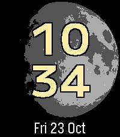

# Pebble Night Heron Watchface

Night Heron is a lunar phase tracker with large digital time overlaid on an image of the moon that waxes and wanes

Features:
* Date included as a row across the bottom
* Updates once per minute, to save battery
* Effects of lunar libration are included
* View of the moon simulated from the center of the earth
* Moon images from https://commons.wikimedia.org/wiki/File:Lunar_libration_with_phase_Oct_2007.gif
* Name inspiration from https://en.wikipedia.org/wiki/Black-crowned_night_heron

Attribution:
* Thanks to Coji Morishita for the M PLUS U font

## Screenshots

### Emery

## License

[![CC BY-SA 4.0][cc-by-sa-shield]][cc-by-sa]

This work (except fonts) is licensed under a
[Creative Commons Attribution-ShareAlike 4.0 International License][cc-by-sa].

[![CC BY-SA 4.0][cc-by-sa-image]][cc-by-sa]

[cc-by-sa]: http://creativecommons.org/licenses/by-sa/4.0/
[cc-by-sa-image]: https://licensebuttons.net/l/by-sa/4.0/88x31.png
[cc-by-sa-shield]: https://img.shields.io/badge/License-CC%20BY--SA%204.0-lightgrey.svg
